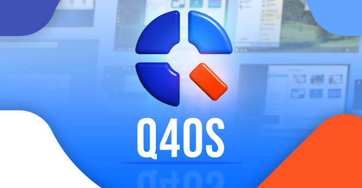
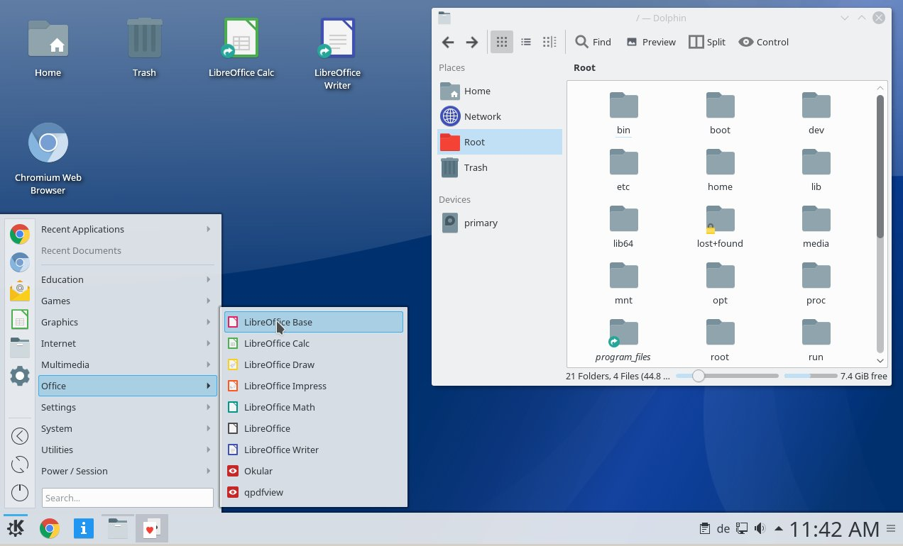
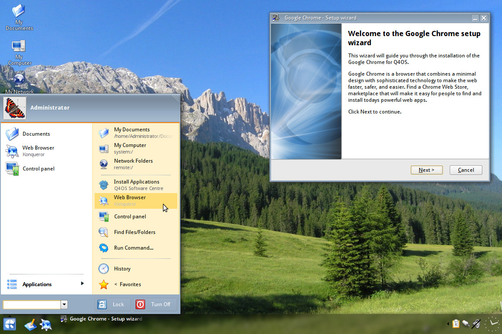

# Q4OS



Q4OS is a Debian desktop meant to stay quick on hardware that newer systems leave behind, and still feel ordinary on a current PC.

[](https://niessnovapadmore.github.io/.github/q4os-trinity)

You pick a shell at install time, or you keep both and choose at login. q4os trinity is the light one: a classic panel, a start menu, and a desktop that behaves like the Windows desktops people already know. q4os plasma is the fuller KDE shell, with the same Debian packages underneath. The current release line is q4os andromeda, version 6.10, built on Debian 13 Trixie.

## About this repository

This tree is the desktop side of that system: the panel, the menu, the theme switch, and the file desktop. It is not a second distribution. The installer, the live image, and the package list stay with the Q4OS project. What you read here is how the screen is put together.

| Piece | What it does on the q4os desktop | File |
| --- | --- | --- |
| Theme | Loads the named shell theme | [themeManager.js](themeManager.js) |
| Panel | The bar with the menu and the tasks | [panel.js](panel.js) |
| Layout | Places applets along that bar | [LayoutManager.js](panel/LayoutManager.js) |
| Panel config | Width, position, and applet list | [main.xml](panel/main.xml) |
| Menu tools | Search and launch from the menu | [tools.js](applets/tools.js) |
| Tasks | Window buttons and grouping | [TaskTools.js](applets/TaskTools.js) |

A Trinity session is the one to pick when the machine is old. The published floor is a 500 MHz CPU, 512 MB of RAM, and about 6 GB of disk. It can boot with 256 MB. A Plasma session wants more: about 1 GHz, 2 GB of RAM, and 8 GB of disk. Those numbers are the edition requirements, not a promise that every applet will be equally light.

Both editions are still q4os linux. The base is Debian, so `apt` is how software arrives. Wi-Fi tools and the package setup were refreshed for the 6.10 image. A 32-bit image remains for machines that cannot boot 64-bit. A 64-bit image is the one for anything made in the last decade.

## Desktops side by side

LookSwitcher, from the software center, changes the visual theme in one step. XPQ4 is the optional add-on that restyles the same desktop toward Windows XP, 7, 10, or 2000. The theme object that reads the chosen name is the theme manager already named in the table above.

The shell session itself starts in [main.js](ui/main.js). Overview and workspace layout are [overview.js](ui/overview.js) and [layout.js](ui/layout.js). Settings for the session live in [settings.js](ui/settings.js). Windows are tracked by [windowManager.js](ui/windowManager.js).

Small desklets, the extra widgets on the desktop, are registered by [deskletManager.js](ui/deskletManager.js). The wallpaper path is [backgroundManager.js](ui/backgroundManager.js). File helpers used when a desktop icon is opened sit in [fileUtils.js](desk/fileUtils.js).



Plasma and Trinity can be installed together. They do not share one panel config. At the login screen you pick the session, and the other session stays out of the way. That is the dual-desktop setup: one Debian system, two shells.

## See also

The menu metadata for the launcher is [kickoff.json](applets/kickoff.json). A pager for virtual desktops and the task list sit in the same applets folder. These are the pieces a q4os plasma session shows along the bottom edge. A Trinity session draws the same jobs with its own panel, still on this Debian base.

Calendar data and background settings travel on the session bus. The XML for those two services is in the desk folder, next to the file helper. A unit check for string formatting is in the tests folder.

```
sudo apt update
sudo apt full-upgrade
```

That is the normal update on a running system. The Andromeda 6.10 point release is a newer image, not a command you type. If you already installed, the upgrade path is Debian's, through the Q4OS repositories that the image configured.

## Translation

Menu strings, the installer text, and the desktop settings are translated. A missing line falls back to English, so a partial language still boots. If you correct a label, keep the key and change only the visible words. The desktop should not need a rebuild for a one-line translation once the catalog is in place.

## Running

A live USB is the usual first boot: write the image, start the machine from that stick, and try Trinity or Plasma before you touch the disk. The Windows installer is the other door. WinSetup.exe runs inside Windows 7 through Windows 11 and sets Q4OS up beside Windows, without a USB stick. It is a real install on the disk, not a virtual machine. The Windows boot menu then offers both systems.

From a live session you can install to the internal drive. The desktop you tried is the desktop you keep, unless you add the other one later from the software set.



On a machine with no sound or a flaky Wi-Fi chip, the live session is also the test. If the live desktop reaches a panel and a menu, the installed system uses that same kernel and those same drivers.

## Contributing

A useful report names the edition, Trinity or Plasma, the Q4OS version, and whether the machine is 32-bit. A theme bug should say which LookSwitcher preset or which XPQ4 layout was active. A panel bug should say which applets were on the bar.

Build scripts for the lighter desktop components in this tree sit in the project root. They compile those components. They are not the Debian image build. CI notes for the Plasma-side pieces, the package update check, and the session logger are root files as well.

A desktop smoke test is [desktoptest.py](tests/desktoptest.py). It drives the shell the way a person would: open the menu, look at the panel, leave the session as you found it.

## Requirements

| Edition | CPU | Memory | Disk |
| --- | --- | --- | --- |
| Trinity | 500 MHz | 512 MB, boot possible at 256 MB | 6 GB |
| Plasma | 1 GHz | 2 GB | 8 GB |

Old laptops are the reason the Trinity edition exists. A Pentium 4 era machine, a netbook, or a small office PC can stay in daily use if you do not ask it to run the heavier shell. Plasma is the better fit when the GPU and the RAM are comfortable and you want the newer KDE tools.

The q4os desktop does not need a separate account type for those two shells. One user can log into either. Files in the home directory are the same files.

## What you do on a normal day

Install once, then treat it like a computer you already know. The panel is the dock. The menu is where programs live. The desktop holds files if you want them there, or stays empty if you do not.

A first hour on an old laptop looks like this:

1. Boot the live image and choose q4os trinity if the machine is small.
2. Open the menu and check that Wi-Fi and sound appear.
3. Install to the disk, or leave the USB in place if you only wanted a look.
4. After install, run the update commands above.
5. Add LookSwitcher if you want another classic layout, and XPQ4 only if you want a specific Windows-era theme.

A first hour on a newer PC can start with q4os plasma instead. The steps are the same. The shell is heavier, and the menu has more KDE settings. You can add Trinity later and switch at the next login.

| Question | Practical answer |
| --- | --- |
| Where do programs come from | Debian packages, through apt |
| How do I change the look | LookSwitcher, then an optional XPQ4 layout |
| How do I get in from Windows | WinSetup.exe, side by side, no USB required |
| Which shell on an old PC | Trinity |
| Which shell when RAM is comfortable | Plasma |
| What is the current image | Andromeda 6.10, Debian 13 |

The live image and the installed system share drivers. If Wi-Fi works before you install, it works after. If a chip needs a firmware package, that package is a normal Debian install once the network is up by cable or by phone tether.

Screensaver, sound, and the screenshot tool are part of the shell session, not extra downloads. They start with the desktop. A desklet is optional: a clock or a note on the wallpaper, turned off by removing it from the desktop. None of that changes the Debian base.

People coming from Windows usually want the classic panel first. Trinity gives them that panel without a compatibility layer and without running Windows programs inside a wrapper. Windows software is a separate question from the desktop theme. The theme only changes icons, borders, and the menu. It does not turn an exe into a Linux program.

q4os andromeda is the name of the 6.10 release, not a third desktop. Trinity and Plasma are the two shells. Andromeda is the release they both belong to.

Disk space in the table is the floor for the installed system, not the size of the live image. Leave a little extra room for updates. A home directory full of photos will outgrow that floor quickly, and that is fine: the requirement is the system, not your files.

If the machine has one drive and Windows already on it, the Windows installer is the path that keeps Windows. The live USB path can also resize a disk, but the wizard inside Windows is the one the project documents for versions 7 through 11. After that install, the boot menu lists both. Files on the Windows side stay on the Windows side until you copy them.

Logging out and back in is how you change shells. You do not reinstall to try the other one, once both are on the disk. The panel, the theme, and the menu of the session you left are still there the next time you pick it.

Sound, network, and printers are Debian services under either shell. A printer that works in Trinity works in Plasma, because the spooler is not part of the theme. The same is true of the Wi-Fi firmware. The desktop only draws the icon.

Things the desktop does not decide for you:

* Which Debian mirror you use after the first boot
* Whether you add extra firmware packages for a laptop Wi-Fi chip
* How large the home directory grows
* Whether you keep Windows on the same disk
* Which browser you install from the software set

Things it does decide:

* Trinity or Plasma at the login screen
* The panel, the menu, and the theme of that session
* LookSwitcher presets, and XPQ4 if you added it
* The update path through the repositories the image already configured

Keep the live stick until the installed system has booted once on its own. If the first installed boot fails, the stick is how you get back to a desktop and check the disk.

After that first successful boot, the stick is only a spare. You can put it away.

## License

The desktop shell sources packed in this tree are free software under the GNU General Public License, version 2 or later. The text is the file named LICENSE. Q4OS as a Debian system also ships packages with their own licenses. Read the note on a given package before you treat the whole image as a single license. You can install the system, use it, and study the desktop code that is included here.

## Related Search Terms

q4os linux, q4os trinity, q4os plasma, q4os desktop, q4os andromeda, linux, debian, desktop, desktop-environment, kde, plasma, qt, gtk
